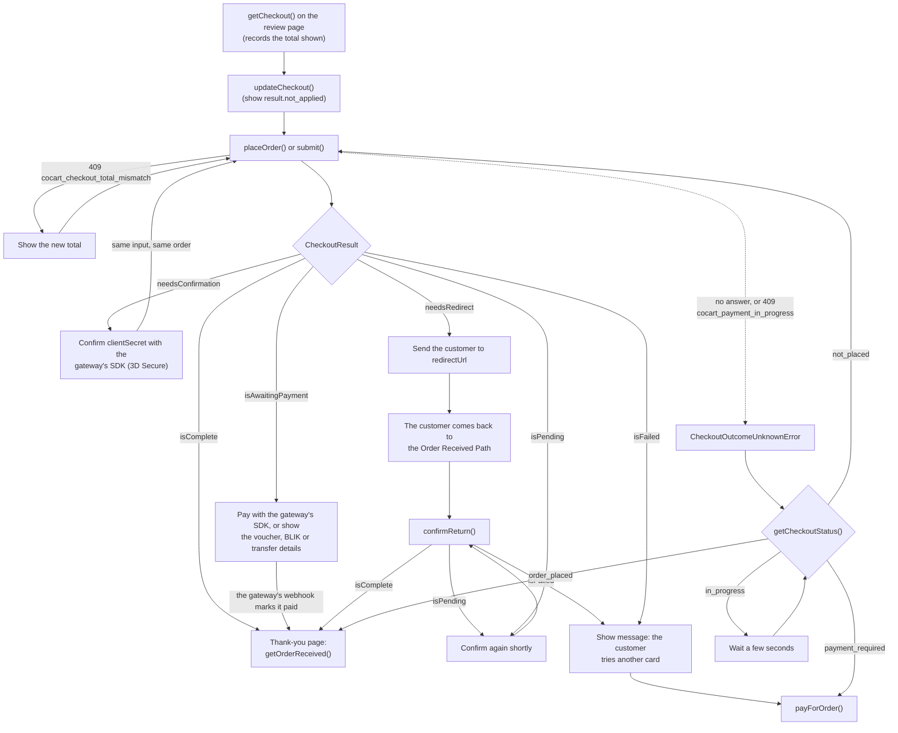

# Checkout Flow

The package is built around the standard Checkout flow (CoCart Plus 2.0):

1. Show the review page with `getCheckout()`: the items, totals, addresses and shipping rates. CoCart Plus records the total the customer saw
2. Fetch payment methods
3. Save billing and shipping details, the shipping rate and the payment method with `updateCheckout()`, and show anything it couldn't apply
4. Place the order and take payment with `placeOrder()` (or `submit()`)
5. Act on the result: show the thank-you page, let the customer pay in the page, confirm the card (3D Secure) and place the order again, send the customer off-site, confirm again shortly, or show why the payment failed
6. If no answer came back, ask `getCheckoutStatus()` how the checkout ended

## Get checkout state

```ts
const state = await client.checkout.getCheckout();
const data = state.toObject();
```

Call it for the page the customer reviews before paying. CoCart Plus remembers the total it showed, and refuses the order with `409 cocart_checkout_total_mismatch` if the total has changed by the time the order is placed (see [When the total changed](#when-the-total-changed)). So don't call `getCheckout()` again right before placing the order: that would record a total the customer never looked at.

`getCheckout()` takes optional `currency` (prices in another currency, on a multi-currency store), `formatted` (amounts ready to display, `"$18.00"`, instead of minor units, `"1800"`) and `thumb` (`false` leaves each item's `featured_image` empty):

```ts
const state = await client.checkout.getCheckout({ formatted: true, thumb: false });
```

The checkout reads like a receipt (`CheckoutState`):

- `cart_key`, `currency`
- `items` (a list), `coupons`, `fees`
- `totals` (`subtotal`, `discount_total`, `shipping_total`, `fee_total`, `total_tax`, `total`…) and `total_lines`, the lines a receipt prints (`key`, `label`, `amount`, `detail`)
- `payment`: `needs_payment` and the chosen `method`
- `customer`: `billing` and `shipping`, each with the address on one line in `formatted`
- `delivery`: `needs_shipping` and `packages`, each with its `id`, `name`, `rates` (`id`, `method_id`, `instance_id`, `label`, `cost`, `tax`) and `chosen_rate`

> [!NOTE]
> There's no `result` with a payment outcome here: the checkout isn't an order yet. Only `placeOrder()`, `submit()`, `payForOrder()` and `confirmReturn()` return an order with what the payment did.

## Get payment methods

```ts
const methodsResponse = await client.checkout.getPaymentMethods();
const paymentMethods = methodsResponse.toObject();

for (const method of paymentMethods) {
  method.id;           // 'stripe'
  method.title;        // 'Credit card'
  method.supports;     // { tokenization: true, save_payment: true, refunds: true, subscriptions: true }
  method.saved_tokens; // the logged-in customer's saved cards for this method
}
```

The response is the list itself, in the order the store sorts them. `supports` is a set of flags, and `restricted_to_shipping_methods` lists the shipping methods a method is limited to (e.g. Cash on delivery with `local_pickup`).

## Saved cards

A logged-in customer's saved cards, flattened from `getPaymentMethods()`'s `saved_tokens`:

```ts
const cards = await client.checkout.getSavedPaymentMethods();          // every gateway
const stripeCards = await client.checkout.getSavedPaymentMethods('stripe');

for (const card of cards) {
  card.id;                    // 7
  card.gatewayId;             // 'stripe'
  card.label;                 // 'Visa ending in 4242'
  card.type;                  // 'CC'
  card.expires;               // '12/2030', or null
  card.isDefault;
  card.supportsSubscriptions; // the gateway can charge subscription renewals
}
```

Pay with one by sending its `id` as `wc-{gatewayId}-payment-token` in `payment_data` (below). A guest has none.

## Update checkout data

```ts
const response = await client.checkout.updateCheckout({
  billing_address: {
    first_name: 'Jane',
    last_name: 'Doe',
    address_1: '1 Main Street',
    city: 'Paris',
    postcode: '75001',
    country: 'FR',
    email: 'jane@example.com',
  },
  shipping_method: 'flat_rate:1',
  payment_method: 'stripe',
});

const checkout = response.toObject();
if (checkout.result?.code === 'checkout_partly_updated') {
  for (const { field, message } of checkout.result.not_applied ?? []) {
    showFieldError(field, message); // e.g. shipping_method: 'The shipping method "local_pickup:999" is not available.'
  }
}
```

`updateCheckout()` saves addresses, the shipping rate, the payment method, the currency or a coupon (`coupon_code`, with `coupon_action` `apply` or `remove`), and returns the checkout with its new totals and what it did in `result`:

| `result.code` | Meaning |
|---|---|
| `checkout_updated` | Everything was applied |
| `checkout_partly_updated` | Some of it was. What wasn't is in `result.not_applied`: `[{ field, code, message }]`, e.g. a coupon the store rejects, or a shipping or payment method that isn't available |

When nothing asked for could be applied, it's an error and nothing changes. Both addresses are checked before either is saved, and every field at fault comes back at once in `error.getFields()` (`{ 'billing.postcode': 'The postcode NOTAPOSTCODE is not valid for France.' }`).

The checkout `updateCheckout()` returns is the one the customer is now looking at, so its total is the one CoCart Plus expects when the order is placed.

## Place the order

`placeOrder()` creates the order and takes payment (`POST /checkout`), and returns a `CheckoutResult`:

```ts
const result = await client.checkout.placeOrder({
  billing_address: {
    first_name: 'Jane',
    last_name: 'Doe',
    address_1: '1 Main Street',
    city: 'Paris',
    postcode: '75001',
    country: 'FR',
    email: 'jane@example.com',
  },
  shipping_method: 'flat_rate:1',
  payment_method: 'stripe',
  payment_data: { 'wc-stripe-payment-method': paymentMethod.id }, // from stripe.createPaymentMethod()
});

if (result.isComplete) {
  // Paid, free, or held for review: show the thank-you page with getOrderReceived(result.orderId, result.orderKey).
} else if (result.isAwaitingPayment) {
  // Placed, and the customer pays now: Cash App Pay, WeChat Pay, a voucher, BLIK, a bank transfer (see below).
  await stripe.confirmCashappPayment(result.clientSecret!, { return_url: result.redirectUrl });
} else if (result.needsConfirmation) {
  // 3D Secure in the page: confirm, then place the order again with the same input.
  const { error } = await stripe.handleNextAction({ clientSecret: result.clientSecret! });
  if (!error) await client.checkout.placeOrder(sameInput);
} else if (result.needsRedirect) {
  window.location.href = result.redirectUrl!; // then confirmReturn() when the customer is back
} else if (result.isPending) {
  // The gateway hasn't confirmed yet: confirmOrderPayment(result.orderId!, result.orderKey!) again shortly, or check the order.
} else if (result.isFailed) {
  showError(result.message); // 'Your card was declined.'; result.errorCode is e.g. 'card_declined'
}
```

`payment_data` is a map of the keys the WooCommerce gateway reads; `placeOrder()` sends it as the `{key, value}` pairs the API wants:

| To… | Key | Value |
|---|---|---|
| Charge a new Stripe card | `wc-stripe-payment-method` | The PaymentMethod ID (`pm_…`) |
| Charge a new WooPayments card | `wcpay-payment-method` | The PaymentMethod ID |
| Charge a saved card | `wc-{gateway}-payment-token` | The saved card's `id` |
| Save the new card for later | `wc-{gateway}-new-payment-method` | `true` |

Offline gateways (`bacs`, `cheque`, `cod`) need no `payment_data`, and a free order needs neither `payment_method` nor `payment_data`. Calling `placeOrder()` again for the same cart lands on the same order.

Each order is sent with a random `checkout_id` (`chk_` and 32 hex digits). Pass your own in the input if you'd rather keep it; it must be 16 to 64 letters, digits, `-` or `_`, or `placeOrder()` throws `checkout_invalid_checkout_id` without sending anything.

A declined card is a failed result (`200`, `payment_failed`), not an exception. Errors before payment (an empty cart, a missing field, an unavailable shipping method) are still thrown as `CoCartError`, and nothing was changed.

## Reading the result

`CheckoutResult` is the same for `placeOrder()`, `submit()` (as `result`), `payForOrder()`, `confirmReturn()` and `account().updateSubscriptionPaymentMethod()`. Each of these returns the order (or, for a subscription's payment method change, the subscription) with what the payment did in `result`:

```json
{
  "object": "order",
  "result": {
    "code": "action_required",
    "message": "Please confirm your payment.",
    "action": { "type": "stripe_confirm_payment", "data": { "client_secret": "pi_…_secret_…", "intent_type": "payment_intent" } },
    "redirect_url": null,
    "error": null
  },
  "id": 2159,
  "number": "2159",
  "key": "wc_order_…",
  "status": { "code": "pending", "label": "Pending payment" }
}
```

`result.code` is one of:

| `code` | Meaning |
|---|---|
| `order_placed` | The order went through: paid, nothing to pay (a 100%-off coupon, a free trial), or held for review or offline payment. The order's `status.code` says which (`processing`, `completed`, `on-hold`) |
| `action_required` | The customer must do something before the payment can complete: 3D Secure in the page, or an off-site step. The order stays `pending`, and the cart and draft order are kept |
| `payment_pending` | The gateway hasn't confirmed the payment yet (usually from `confirmReturn()`) |
| `payment_failed` | Declined, errored, or cancelled at the provider. The cart and draft order are kept, and the order can be paid again |
| `payment_method_changed` | A subscription's payment method changed (instead of `order_placed`) |

`CheckoutResult` reads it for you:

| Member | Meaning |
|---|---|
| `code` | `result.code`, as sent (`PaymentResultCode`; open-ended, so a value a store or gateway adds still comes through). A response with no `result.code` reads as `payment_failed`, never as complete |
| `isComplete` | `order_placed` or `payment_method_changed`, with no `action`: show the thank-you page |
| `isAwaitingPayment` | `order_placed` **with** an `action`: the order is placed but the customer still pays, outside the checkout. With a `clientSecret`, in the page (Cash App Pay, WeChat Pay, Boleto, OXXO or Multibanco vouchers); otherwise `actionType` says what to show (BLIK approval, a Multibanco voucher, bank transfer instructions, a Pix QR code). The gateway's webhook marks the order paid: don't place it again |
| `needsConfirmation` | `action_required` with a `clientSecret`: confirm it in the page (3D Secure), then make the same call again |
| `needsRedirect` | `action_required` with an off-site `redirectUrl` and no `clientSecret`: send the customer there, then call `confirmReturn()` when they come back |
| `isPending` | `payment_pending`: the gateway hasn't confirmed yet. Confirm again shortly, or check the order |
| `isFailed` | `payment_failed`: show `message`. The order can be paid again with `payForOrder()` |
| `object` | `order`, or `subscription` after a subscription's payment method change |
| `orderId`, `orderKey`, `orderNumber`, `orderStatus` | The order's `id`, `key`, `number` and `status.code`, when `object` is `order` |
| `subscriptionId` | The subscription's `id`, when `object` is `subscription` |
| `redirectUrl` | With `action_required`, the off-site step; otherwise `result.redirect_url`, the order-received page (or the gateway's own). Only ever an `https` or `http` address: anything else in the response (a `javascript:` URL, another app's link) is left out |
| `clientSecret`, `intentType` | For `needsConfirmation` (`payment_intent` or `setup_intent`) and `isAwaitingPayment` |
| `paymentMethodType` | For `isAwaitingPayment` with a `clientSecret`: `cashapp`, `wechat_pay`, `boleto`, `oxxo` or `multibanco` |
| `message` | A sentence for the customer, set for every code: that the order was received, what to do next, or why the payment failed |
| `errorCode`, `gatewayErrorCode`, `gatewayMessage` | With `payment_failed`: `result.error.code`, `.gateway_code` and `.gateway_message` (see below) |
| `actionType`, `actionData` | `result.action.type` and `.data`, e.g. `stripe_confirm_payment` with `{ client_secret, intent_type }`, or a Multibanco voucher alongside `order_placed` |
| `response` | The raw `Response`: the order, or the subscription |

A failed payment's `errorCode` says why, so the storefront can react without parsing the message: `card_declined`, `insufficient_funds`, `expired_card`, `incorrect_cvc`, `incorrect_number`, `incorrect_postcode`, `authentication_failed`, `processing_error`, `payment_method_not_supported`, `amount_not_supported`, or `payment_failed` when the gateway didn't say (types: `PaymentError`, `PaymentErrorCode`). Stripe and WooPayments report their reasons. Show `message` to the customer; `gatewayErrorCode` and `gatewayMessage` are the gateway's own, for logging.

```ts
if (result.isFailed && result.errorCode === 'incorrect_cvc') {
  focusCvcField();
}
```

### When the customer pays after the order is placed

With these payment methods the order is placed before the customer pays, and `isAwaitingPayment` is `true`. The cart was emptied when the order was placed, the gateway's webhook marks the order paid, and `getCheckoutStatus()` says `payment_required` until the payment goes through, then `order_placed`. Don't place the order again.

With a `clientSecret` (Stripe's Cash App Pay, WeChat Pay and vouchers), call the Stripe.js method for `paymentMethodType`, as the Stripe gateway's own checkout does. Stripe shows the QR code, sends the customer to Cash App on a phone, or shows the voucher:

| `paymentMethodType` | Stripe.js call |
|---|---|
| `cashapp` | `confirmCashappPayment(clientSecret, { return_url })`, or `confirmCashappSetup()` for a `seti_…` secret (a free trial) |
| `wechat_pay` | `confirmWechatPayPayment(clientSecret, { payment_method_options: { wechat_pay: { client: 'web' } } })` |
| `boleto`, `oxxo`, `multibanco` | `confirmBoletoPayment(clientSecret)`, `confirmOxxoPayment()` or `confirmMultibancoPayment()` |

Use `redirectUrl` (the order-received URL) as Cash App's `return_url`. A voucher is paid later, at a bank or a shop. If the customer abandons Cash App, the order stays unpaid: `payForOrder()` takes another payment for it. `submit()` with `createStripeGateway` makes these calls for you.

Without a `clientSecret`, show what `actionType` and `actionData` describe:

| `actionType` | Show |
|---|---|
| `stripe_blik_confirmation_pending` | Ask the customer to approve the payment in their banking app. Nothing else to send |
| `wcpay_multibanco_voucher` | `entity` and `reference` (or a link to `voucher_url`), to pay before `expires_at` |
| `mollie_bank_transfer_instructions` | `beneficiary_name`, `iban`, `bic` and `payment_reference`, to pay before `expires_at` |
| `mercadopago_pix_payment` | The QR code (`qr_code_base64`, or the copy-paste `qr_code`), to pay before `expires_at` |
| `mercadopago_ticket_payment` | A link to `voucher_url` |

### The whole flow

Including the lock CoCart Plus takes so that a double tap, or a request sent again, can't take payment twice:



### When no answer comes back

The client never sends `placeOrder()` again by itself after a timeout, since it may already have run on the store. When no answer comes back (the connection dropped, the request timed out, or a proxy gave up waiting), or another request is still taking payment for the cart (`409 cocart_payment_in_progress`, e.g. after a double tap), `placeOrder()` throws `CheckoutOutcomeUnknownError` with the `checkout_id` it sent, and `getCheckoutStatus()` asks CoCart Plus how the checkout ended:

```ts
import { CheckoutOutcomeUnknownError } from '@cocartheadless/checkout';

try {
  result = await client.checkout.placeOrder(input);
} catch (error) {
  if (!(error instanceof CheckoutOutcomeUnknownError)) throw error;

  const status = await client.checkout.getCheckoutStatus(error.checkoutId);
  switch (status.code) {
    case 'order_placed':     // It went through: show status.orderId with status.orderKey.
    case 'payment_required': // Placed but not paid: payForOrder(status.orderId!, status.orderKey!, …).
    case 'in_progress':      // Still running: ask again in a few seconds.
    case 'not_placed':       // Nothing went through: placeOrder(input) again. It reuses the draft order.
  }
}
```

`getCheckoutStatus()` returns `{ checkoutId, code, message, orderId, orderKey, orderNumber, orderStatus }`. The order fields are `null` unless the code is `order_placed` or `payment_required`; `orderStatus` is the order's `status.code`. Ask from the same cart, or as the same customer: anyone else gets `403 cocart_checkout_not_yours`, and an ID no checkout from this cart was sent with is `404 cocart_checkout_not_found`. Only orders placed in the last day are found.

`CheckoutOutcomeUnknownError` is a `CoCartError` with the original error's codes (`request_timeout`, `network_error`, the proxy's 502 or 504, or `cocart_payment_in_progress`), so code that already catches `CoCartError` keeps working.

If the gateway's webhook paid the order after a 3D Secure confirmation in the page, placing the order again reports that order as complete rather than placing another.

### When the total changed

If the total changed since the customer last saw it (a price, a coupon or a shipping rate changed), the order is refused with `409 cocart_checkout_total_mismatch`, and no payment is taken:

- From `placeOrder()`, CoCart Plus refuses it, keeping the address that was sent. Get the checkout again with `getCheckout()`, show the new total, and once the customer accepts it, the same `placeOrder()` goes through.
- `submit()` checks it before taking payment, against the total of the last `getCheckout()` or `updateCheckout()`, including the update it sends itself. It throws the same error with the new checkout in `error.responseData.data.checkout`, and counts the new total as shown.

```ts
import { CoCartError } from '@cocartheadless/sdk';
import type { CheckoutState } from '@cocartheadless/checkout';

try {
  await client.checkout.submit(input);
} catch (error) {
  if (error instanceof CoCartError && error.errorCode === 'cocart_checkout_total_mismatch') {
    const checkout = (error.responseData.data as { checkout?: CheckoutState } | undefined)?.checkout;
    showNewTotal(checkout ?? (await client.checkout.getCheckout()).toObject());
    return; // the customer submits again once they've seen it
  }
  throw error;
}
```

It's a `409`, so it's never a `ValidationError`.

## Process checkout

`processCheckout()` is the low-level call behind `placeOrder()`: it sends `payment_data` as you give it and returns the raw response, the order with `result`. Read it with `CheckoutResult.fromResponse()`:

```ts
import { CheckoutResult } from '@cocartheadless/checkout';

const response = await client.checkout.processCheckout({
  billing_address: {
    first_name: 'Jane',
    address_1: '1 Main Street',
    city: 'Paris',
    postcode: '75001',
    country: 'FR',
  },
  payment_method: 'stripe',
  shipping_method: 'flat_rate:1',
  payment_data: [
    { key: 'wc-stripe-payment-method', value: 'pm_123' },
  ],
});

const result = CheckoutResult.fromResponse(response);
```

`processCheckout()` doesn't send a `checkout_id` unless you put one in, and doesn't turn a lost answer into `CheckoutOutcomeUnknownError`: prefer `placeOrder()`.

> [!NOTE]
> `payment_data` is an array of `{ key, value }` pairs on the wire, not a plain object. `placeOrder()` and `submit()` (below) handle this conversion for you — gateway adapters' `tokenize()` still returns a plain object like `{ 'wc-stripe-payment-method': 'pm_123' }`, which `submit()` converts before sending. Only convert it yourself if you call `processCheckout()` directly. The `key` must match the literal `$_POST` field the target WooCommerce gateway reads (e.g. `wc-stripe-payment-method` for the WooCommerce Stripe Gateway, `wcpay-payment-method` for WooPayments) — an arbitrary key like `payment_intent_id` is silently ignored.

## Resolving action_required

```ts
const result = await client.checkout.placeOrder(input);

if (result.code === 'action_required') {
  console.log(result.actionType, result.actionData);

  // Resolve the action client-side, then place the SAME cart/session again —
  // it lands on the same order rather than creating a duplicate.
  const retry = await client.checkout.placeOrder(input);
}
```

The order and cart session are deliberately left intact when `action_required` comes back. An action resolved in the page (`stripe_confirm_payment`/`wcpay_confirm_payment`) is followed by placing the order again; an off-site step (`action.data.redirect`, e.g. a Stripe-hosted 3D Secure page) is finished by the gateway when the customer returns — see [Returning from an off-site payment step](#returning-from-an-off-site-payment-step). Known `action.type` values (not exhaustive — see `CheckoutActionType`):

| `action.type` | Gateway | `action.data` | What to do |
|---|---|---|---|
| `stripe_confirm_payment` | WooCommerce Stripe Gateway | `client_secret`, `intent_type` | `stripe.confirmCardPayment(clientSecret)` (or `confirmCardSetup(clientSecret)` if `intent_type === 'setup_intent'`) — no `elements` needed, the PaymentMethod is already attached to the intent server-side — then retry. Handled automatically by `createStripeGateway`'s `confirmAction`. |
| `wcpay_confirm_payment` | WooPayments | `client_secret`, `intent_type` | Same as above — WooPayments is Stripe-based too. Handled automatically by `createWooPaymentsGateway`'s `confirmAction`. |
| `paypal_approve` | PayPal Payments (`ppcp-gateway`) | `redirect` — a URL | Open the PayPal-hosted approval URL. Completion is async (webhook-driven) — retry once the order is actually paid, not immediately after the redirect returns. No pre-wired factory; see [Gateways → PayPal Payments](gateways.md#paypal-payments). |
| `paypal_confirm_3ds` | PayPal Payments (`ppcp-credit-card-gateway`) | `redirect` — a URL | Open PayPal's 3D Secure step-up URL. The return URL must carry the same `ppcp_resume_nonce` PayPal generated — send it back in `payment_data` on retry. |
| `mercadopago_confirm_3ds` | Mercado Pago (card) | `redirect`, `creq`, `last_four_digits` | Open the 3D Secure challenge, submitting `creq` as Mercado Pago's JS SDK expects, then retry. |
| `elavon_checkout_js_payment` | Elavon Converge | `transaction_token`, `sdk_url`, `transaction_id_field`, `token_field`… | Load Elavon's Checkout.js from `sdk_url` with `transaction_token`, then retry with the transaction ID it returns under the `payment_data` key named in `transaction_id_field`. |
| `razorpay_checkout_subscription` | Razorpay Subscriptions | Razorpay's `checkout.js` options | Pass them to `new Razorpay(options).open()`. The widget finishes the order itself; no retry. |
| `gateway_redirect_required` | Any gateway without a dedicated compat integration, and Stripe when it sends the customer to a Stripe-hosted 3D Secure page | `redirect` — a URL | Send the customer to `redirect` (`needsRedirect`). When they come back, call `confirmReturn()` (see below). `submit()` returns this URL as `redirectUrl` instead of retrying. |

If a gateway reports success with genuinely nothing to act on, the API reports `payment_failed` instead of an unresolvable `action_required` — you'll never be stuck polling for an action that isn't coming.

If you're using a pre-wired gateway from `gateways.ts` (Stripe, WooPayments, Stripe Express) with `submit()`, the `stripe_confirm_payment`/`wcpay_confirm_payment` retry loop is handled for you automatically via the gateway adapter's `confirmAction` — see [Gateways → Confirming action_required](gateways.md#confirming-action_required). PayPal Payments' redirect-based actions (`paypal_approve`/`paypal_confirm_3ds`) have no pre-wired factory — see [Gateways → PayPal Payments](gateways.md#paypal-payments) for the pattern.

### Returning from an off-site payment step

Gateways build their return URL from the store's order-received URL, which CoCart Plus rewrites to your **Front-end site URL** (and **Order Received Path**, e.g. `/order/{order_id}`) — so after a Stripe-hosted 3D Secure page the customer lands on your frontend, with the gateway's and Stripe's parameters on the query string. Nothing on WordPress sees that return, so the frontend tells CoCart:

```ts
// On the frontend's order-received page (e.g. /order/[id]):
const result = await client.checkout.confirmReturn(window.location.href);

if (result.isComplete) {
  // Paid. Show the thank-you page: getOrderReceived(result.orderId, result.orderKey).
} else if (result.isPending) {
  // Not confirmed yet (e.g. the webhook is still settling it): call confirmReturn() again shortly.
} else if (result.isFailed) {
  // Declined or cancelled at the provider: show result.message, offer payForOrder().
}
```

`confirmReturn()` returns a `CheckoutResult`. It reads `order_id` and `key` from the URL and forwards every query parameter to `POST /order-received/{id}/confirm`, with the order key in the request body, which runs the gateway's own completion logic. Pass `{ orderId, orderKey }` if your route carries them elsewhere, or call `confirmOrderPayment(orderId, orderKey, returnParams)` directly for the raw response. It's safe to call more than once: an order that's already paid is reported as `order_placed`. Keep the gateway's webhooks enabled as a safety net for customers who close the tab before the page loads.

`getCheckoutConfig()` gives the URL customers come back to as `order_received_url`, e.g. `https://shop.example.com/order/{order_id}?key={order_key}&order_id={order_id}`, so you know which route (or, in an app, which link) to handle.

A subscription's payment method change can send the customer off-site too (`needsRedirect` from `account().updateSubscriptionPaymentMethod()`, e.g. a bank). They come back the same way, with the subscription's ID, and `confirmReturn()` finishes the change: `object` is `subscription`, `subscriptionId` is set, and the code is `payment_method_changed` (`isComplete`) once the new payment method is set, `payment_pending` (`isPending`) while it isn't confirmed yet, or `payment_failed` (`isFailed`) when it wasn't confirmed and the customer should choose it again.

## One-call orchestration

Use `submit()` when you want the SDK to run the common update + process (+ `action_required` retry, if the gateway supports it) sequence for you. It returns `{ result, processResponse, updateResponse, paymentData, redirectUrl }`, where `result` is the `CheckoutResult` of the final `POST /checkout`:

```ts
const { result, redirectUrl } = await client.checkout.submit({
  gatewayId: 'stripe',
  update: {
    billing_address: {
      first_name: 'Jane',
      last_name: 'Doe',
      address_1: '1 Main Street',
      city: 'Paris',
      postcode: '75001',
      country: 'FR',
      email: 'jane@example.com',
    },
  },
  process: {
    shipping_method: 'flat_rate:1',
  },
});

if (redirectUrl) {
  window.location.href = redirectUrl; // an off-site step: confirmReturn() when the customer is back
} else if (result.isComplete || result.isAwaitingPayment) {
  // Placed (for isAwaitingPayment without a clientSecret, also show the actionType's details, e.g. BLIK).
  showThankYou(result.orderId!, result.orderKey!);
} else if (result.isFailed) {
  showError(result.message);
}
```

Before taking payment, `submit()` makes sure the checkout's total is still the one the customer was last shown (by `getCheckout()` or `updateCheckout()`), and throws `409 cocart_checkout_total_mismatch` with the new checkout otherwise — see [When the total changed](#when-the-total-changed). It doesn't send a `checkout_id`; for recovery from a lost answer, use `placeOrder()`.

With `createStripeGateway`, `submit()` also takes the Cash App Pay, WeChat Pay or voucher payment for an order placed with an action (`isAwaitingPayment`), without retrying. If the customer doesn't finish that payment, `submit()` throws `checkout_payment_not_completed`, and the error's `responseData` has the unpaid order's `order_id` and `order_key` for `payForOrder()`.

`successUrl` and `returnUrl` are set once at the extension level in `createCheckout()` and passed automatically into every gateway's `tokenize` context — you do not need to repeat them in `submit()`. The `{CHECKOUT_ID}` placeholder in `successUrl` is replaced with the checkout state's `cart_key` at submission time.

---

## Shipping Methods

Fetch the shipping packages before rendering the form. Each package has its `rates` (a list) and its `chosen_rate`. Pass the rates to `createForm()` to get a `shipping-methods` section with a `radio` field. Send the chosen rate's `id` as `shipping_method`.

```ts
const packages = await client.checkout.getShippingMethods();
const rates = packages.flatMap((pkg) => pkg.rates);

const form = client.checkout.createForm({ shippingMethods: rates });

// On submit
const { result } = await client.checkout.submit({
  gatewayId: 'stripe',
  update: {
    billing_address: { /* ... */ },
    shipping_method: 'flat_rate:1', // the chosen rate's id
  },
});
```

See [Shipping Methods](shipping.md) for the full pattern including multi-package support.

---

## Coupons

Apply or remove a coupon before submitting. Both go through `updateCheckout()` and return the checkout with its new totals. Check `payment.needs_payment`, because a coupon may reduce the total to zero.

```ts
const checkout = (await client.checkout.applyCoupon('SAVE10')).toObject();
const needsPayment = checkout.payment.needs_payment;
```

To remove a coupon:

```ts
await client.checkout.removeCoupon('SAVE10');
```

A coupon the store rejects is a `400 cocart_coupon_not_applied` error with the reason as its message. Sent with other changes in `updateCheckout({ coupon_code, coupon_action })`, it's listed in `result.not_applied` instead, and the rest is applied.

See [Coupons](coupons.md) for the full recommended pattern including order summary and zero-total handling.

---

## Order Summary

`getOrderSummary()` fetches the checkout and returns a typed `CheckoutOrderSummary` with items, applied coupons, totals, and the receipt lines:

```ts
const summary = await client.checkout.getOrderSummary();

// summary.items    — CheckoutSummaryItem[]  ({ key, name, quantity, price, subtotal })
// summary.coupons  — CheckoutSummaryCoupon[] ({ code, label, saving })
// summary.totals   — CheckoutSummaryTotals
// summary.lines    — the checkout's total_lines: [{ key, label, amount, detail }]

console.log(summary.totals.total);           // e.g. '2480'
console.log(summary.totals.discount_total);  // e.g. '200'
```

Amounts are in minor units unless the checkout was fetched with `formatted: true`. `getOrderSummary()` calls `getCheckout()`, so it also records the total shown: use it for the review page, not right before placing the order.

To include a structural placeholder section in your form definition, pass `includeSummary: true` to `createForm()`:

```ts
const form = client.checkout.createForm({ includeSummary: true });
// Adds { id: 'order-summary', fields: [], className: theme.orderSummaryClassName }
// Populate it by calling getOrderSummary() and rendering the returned data.
```

---

## Checkout Config

`getCheckoutConfig()` is public — it works before a cart session exists — and returns the store's field definitions, locale overrides, country/state lists, and shipping/account/store/validation settings. Use it to build a checkout form dynamically instead of hardcoding field lists.

```ts
const configResponse = await client.checkout.getCheckoutConfig();
const config = configResponse.toObject();

console.log(config.fields?.billing);            // CheckoutFieldDefinition[]
console.log(config.countries?.allowed_countries); // { US: 'United States (US)', ... }
console.log(config.shipping?.enabled);           // boolean
console.log(config.account?.allow_registration); // boolean — whether to show a "create account" field
console.log(config.store?.currency?.currency_code); // 'USD'
console.log(config.validation?.postcode?.patterns?.['US']); // regex string, informational only
console.log(config.order_received_url); // 'https://shop.example.com/order/{order_id}?key={order_key}&order_id={order_id}'
console.log(config.address_autocomplete); // { enabled: true, providers: [{ id: 'google', name: 'Google Places' }] }
console.log(config.store?.terms_text);   // 'I agree to the terms and conditions & the privacy policy.'
console.log(config.store?.terms_links);  // [{ text: 'terms and conditions', url: 'https://…' }, …]
```

`config.account` is also the source of truth for whether the [Registration](../../../docs/account.md#registration) flow should be exposed: check `allow_registration` before showing a "create an account" option, and `registration_generate_username`/`registration_generate_password` to decide whether to collect those fields at all.

`store.terms_text` is the terms checkbox's label as plain text (`null` without a terms page); link each `terms_links` entry's `text` to its `url`. `store.terms_url` and `store.privacy_url` are the pages themselves.

---

## Address Autocomplete

`searchAddresses()` and `getAddressDetails()` wrap the store's configured address-autocomplete provider (e.g. Google Places). Both are public and don't require a cart session. Check `getCheckoutConfig()`'s `address_autocomplete.enabled` first.

```ts
const results = await client.checkout.searchAddresses({
  query: '123 Main',   // minimum 3 characters
  country: 'US',       // optional — defaults to session/store country
  type: 'billing',      // 'billing' | 'shipping'
});
const { suggestions, provider } = results.toObject();

// suggestions: [{ id: 'addr_12345', label: '123 Main Street, Beverly Hills, CA 90210', matched_substrings: [...] }]

const detailsResponse = await client.checkout.getAddressDetails({
  address_id: suggestions[0].id,
  provider: provider.id,
});
const { address } = detailsResponse.toObject();
// address: { address_1, address_2, city, state, postcode, country }
```

If no provider is configured, `searchAddresses()`/`getAddressDetails()` throw a `CoCartError` (`404`) with code `cocart_address_search_no_provider` / `cocart_address_details_no_provider` — treat address autocomplete as progressive enhancement and fall back to manual entry.

---

## Order Received / Pay for Order

After the order is placed, use `getOrderReceived()` to render a thank-you/confirmation page — it works for both guests (with the order key) and logged-in customers (who must own the order). A wrong key, or someone else's order, is `404 cocart_order_not_found`.

```ts
const orderResponse = await client.checkout.getOrderReceived(result.orderId!, result.orderKey!, { formatted: true });
const order = orderResponse.toObject();

console.log(order.number);                // '2159'
console.log(order.status.label);          // 'Processing'
console.log(order.items);                 // OrderLineItem[]
console.log(order.total_lines);           // OrderTotalLine[] — display-ready { key, label, amount, detail }
console.log(order.payment.needs_payment); // false once paid
```

`getOrderReceived()` takes optional `formatted` and `meta_keys` (only these keys in the order's `meta`).

If `payment.needs_payment` is `true` (a failed payment, or a customer who abandoned checkout on a `pending` order and came back), the order's `allowed_actions` include `pay`, and `payForOrder()` takes payment for it:

```ts
const result = await client.checkout.payForOrder(order.id, order.key, {
  payment_method: 'stripe',
  payment_data: { 'wc-stripe-payment-method': 'pm_123' },
});

if (result.isComplete) {
  // Paid.
} else if (result.isFailed) {
  showError(result.message);
}
```

`payForOrder()` returns the same `CheckoutResult` as `placeOrder()`, read the same way: a declined card is a failed result, not an exception. The order key goes in the request body, not the URL. An order that needs no payment (`cocart_order_no_payment_needed`) or can't be paid in its status (`cocart_order_invalid_status`) is a `409`, and so is another payment still running for it (`cocart_payment_in_progress`): from `payForOrder()` that's an ordinary `CoCartError`, so check the order before trying again.

---

## Security notes

- `payment_data` carries what the gateway's own SDK gives you (a PaymentMethod ID, a saved card's `id`, a confirmation token), never card numbers or CVCs. Card details go straight from the gateway's fields (Stripe Elements, PayPal's buttons…) to the gateway.
- `message`, `gatewayMessage`, `result.not_applied[].message` and error messages are plain text. Render them as text (`textContent`, or JSX `{message}`), never as HTML.
- `redirectUrl` is only ever an `https` or `http` address; `CheckoutResult` leaves anything else out. If you read `result.redirect_url`, `action.data.redirect` or a `voucher_url` from the raw response yourself, check the scheme the same way before sending the customer there.
